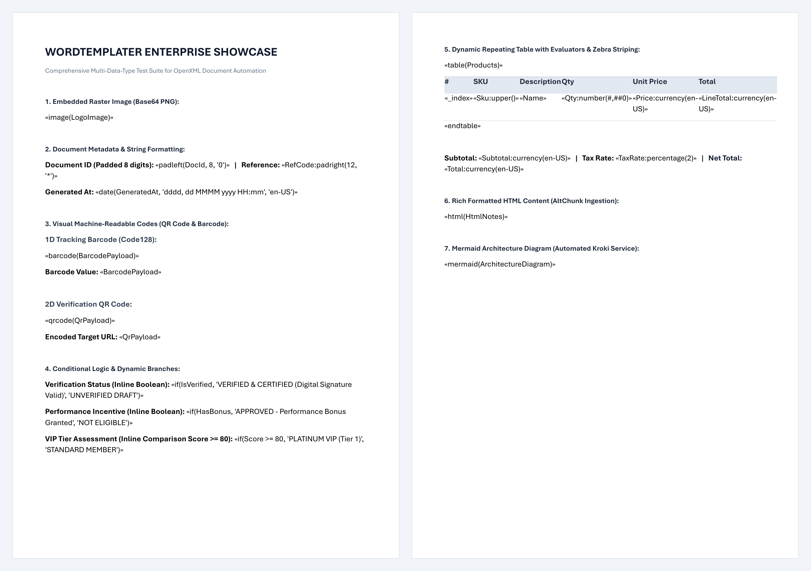

# WordTemplater

[](https://www.nuget.org/packages/WordTemplater)
[](https://www.nuget.org/packages/WordTemplater)
[](https://dotnet.microsoft.com/)
[](LICENSE.txt)

**WordTemplater** is a high-performance, cross-platform .NET library that turns Microsoft Word (`.docx`) documents into dynamic report templates. Design your templates visually in Microsoft Word using standard **MergeFields** (or `«field»` tags), and populate them with complex JSON or C# objects in milliseconds.

No Microsoft Office installation or COM Interop required. Runs seamlessly on Windows, Linux, macOS, Docker containers, and cloud serverless environments.

---

## Table of Contents
- [Multi-Language Ecosystem](#multi-language-ecosystem)
- [Key Features](#key-features)
- [Installation](#installation)
- [How It Works](#how-it-works)
- [Interactive Desktop GUI Studio](#interactive-desktop-gui-studio)
- [Quick Start](#quick-start)
- [Template Syntax & Evaluators Cheat Sheet](#template-syntax--evaluators-cheat-sheet)
  - [1. Text & String Formatting](#1-text--string-formatting)
  - [2. Numbers & Currency](#2-numbers--currency)
  - [3. Dates & Times](#3-dates--times)
  - [4. Logic & Fallbacks](#4-logic--fallbacks)
  - [5. Deep JSON & Property Navigation](#5-deep-json--property-navigation)
  - [6. Repeating Lists & Loops](#6-repeating-lists--loops)
  - [7. Repeating Tables & Zebra Striping](#7-repeating-tables--zebra-striping)
  - [8. Images, Barcodes & Media](#8-images-barcodes--media)
  - [9. Dynamic Watermarks](#9-dynamic-watermarks)
- [Custom Evaluators (Extensibility)](#custom-evaluators-extensibility)
- [Advanced Export Options](#advanced-export-options)
- [Running Tests & Example Project](#running-tests--example-project)
- [License](#license)

---

## Multi-Language Ecosystem

WordTemplater is available across multiple programming languages with matching template syntax and feature parity:

| Language | Repository | Package / Install |
| :--- | :--- | :--- |
| **C# (.NET)** *(This repository)* | [WordTemplater](https://github.com/luuducly/WordTemplater) | `dotnet add package WordTemplater` |
| **TypeScript / JavaScript** | [WordTemplater-ts](https://github.com/luuducly/WordTemplater-ts) | `npm install wordtemplater-ts` |
| **Python** | [WordTemplater-python](https://github.com/luuducly/WordTemplater-python) | `pip install wordtemplater` |
| **Java** | [WordTemplater-java](https://github.com/luuducly/WordTemplater-java) | `com.github.luuducly:wordtemplater` |

---

## Key Features

- 🎨 **Visual Template Design**: Design invoices, contracts, and certificates directly in Microsoft Word or LibreOffice.
- ⚡ **Zero Office Dependency**: 100% managed code built on [DocumentFormat.OpenXml](https://github.com/dotnet/Open-XML-SDK).
- 🐧 **True Cross-Platform**: Fully tested on Linux, macOS, and Windows. Multi-targeted for **.NET 8 (LTS)**, **.NET 9**, and **.NET 10**.
- 🧭 **Deep JSON Navigation**: Access nested fields (`Customer.Address.City`) and array indices (`Items[0].Name`) case-insensitively.
- 📊 **Table & Loop Automation**: Effortless table row cloning, dynamic alternating zebra-striping, and loop metadata (`_index`, `_first`, `_last`, `_even`, `_odd`).
- 🖼️ **Multi-Format Media Insertion**:
  - Images directly from file paths, HTTPS URLs, `byte[]`, `Stream`, or Base64 strings.
  - Dynamic QR Codes and Code128 Barcodes.
  - Flowcharts and state diagrams via [Mermaid](https://mermaid.js.org/).
  - Raw HTML and nested sub-DOCX documents.
- 🛡️ **Document Watermarking**: Inject customizable diagonal or horizontal text watermarks into all sections/headers dynamically.
- 🧩 **Extensible Plugin Engine**: Register custom evaluators and formatters with a single interface (`IEvaluator`).

---

## Installation

Install the package via NuGet:

### .NET CLI
```bash
dotnet add package WordTemplater --version 2.1.6
```

### Package Manager Console
```powershell
Install-Package WordTemplater -Version 2.1.6
```

### PackageReference
```xml
<PackageReference Include="WordTemplater" Version="2.1.6" />
```

---

## How It Works

<p align="center">
  
</p>

WordTemplater bridges visual document authoring in Microsoft Word with high-performance, automated data binding:

1. **Design Visually in Microsoft Word**:
   - Insert standard Word **MergeFields** (`Ctrl + F9` or `Insert -> Quick Parts -> Field -> MergeField`) or simple guillemets (`«field»`).
   - Use built-in formatters and evaluators directly within field codes:
     - **Text & Padding**: `«upper(Name)»`, `«padleft(DocId, 8, '0')»`, `«date(CreatedAt, 'dd/MM/yyyy')»`
     - **Financial & Numeric**: `«currency(Total, 'vi-VN')»`, `«percentage(TaxRate)»`, `«number(Qty, '#,##0')»`
     - **Machine-Readable Identifiers**: `«qrcode(Url)»`, `«barcode(Sku)»`, `«image(Logo)»`
     - **Rich Media & Ingestion**: `«html(Notes)»`, `«mermaid(WorkflowDiagram)»`
     - **Conditional Branches**: `«if(Score >= 80, 'VIP Tier', 'Standard')»`
     - **Dynamic Tables & Loops**: `«table(Products)»` ... `«endtable»`, `«loop(Items)»` ... `«endloop»`
     - **Exact Pre-printed Overlays**: Absolute-positioned **DrawingML Text Shapes** positioned seamlessly over pre-printed dot lines (`.......`) in headers, bodies, or footers.

2. **Supply Data**:
   - Bind any data model: C# POCO classes, anonymous objects, `Newtonsoft.Json.Linq.JObject`, raw JSON strings, or dictionaries.
   - Access deeply nested properties (`Customer.Address.City`) and array items (`Items[0].Price`) case-insensitively.

3. **Export High-Fidelity Documents**:
   - WordTemplater parses the document XML, clones repeating table rows, formats numbers/dates, renders QR/barcodes/diagrams, and outputs a complete `.docx` file or memory stream in milliseconds with **zero Microsoft Office dependency**.

---

## Interactive Desktop GUI Studio

A cross-platform desktop application built with [Avalonia UI](https://avaloniaui.net/) is included directly in the repository at [`examples/WordTemplater.Desktop`](examples/WordTemplater.Desktop). It allows developers and designers to test features, experiment with templates, edit JSON payloads, and inspect generated documents instantly on **macOS, Linux, and Windows**.

### Launching the Studio

Run the application with a single CLI command from the repository root:

```bash
dotnet run --project examples/WordTemplater.Desktop
```

### Key Capabilities

- 🌟 **Built-in Interactive Templates**:
  - **Enterprise Full Showcase**: Comprehensive template demonstrating QR codes, Code128 barcodes, raster images, inline conditions, HTML altChunks, Mermaid diagrams, table row cloning, and currency formatters.
  - **Pre-printed Bill / Voucher**: Demonstrates absolute DrawingML Text Shapes positioned directly over pre-printed dotted blank lines (`.....`) across Header, Body, and Signatures.
  - **Invoice & Employee Summaries**: Tables with dynamic zebra striping, currency formatters, and deep JSON structures.
  - **Custom DOCX Picker**: Load and test your own external `.docx` template files.
- ✏️ **Direct In-Word Template Redesign**:
  - Click the **"✏️ Mở File Template trong Word (.docx)"** button to immediately open any template in Microsoft Word.
  - Drag, resize, or reposition text shapes and edit fields visually in Word, save (`Cmd + S` / `Ctrl + S`), and the Desktop App automatically reloads your changes on the next export.
- 📝 **Live JSON Editor**:
  - Full-featured JSON editor with automatic sample data population for each template.
  - **✨ Format JSON** button for instant pretty-printing and formatting.
- 🎨 **Visual Export Controls**:
  - Toggle and customize dynamic text watermarks (text, hex color, rotation angle).
  - Enable table zebra striping with custom odd and even row background colors.
- ⚡ **Instant Export & Document Viewer**:
  - Click **"⚡ Generate & Export Document"** to render in milliseconds.
  - Click **"📖 Open Exported Document (.docx)"** to inspect the finished document in your default word processor.

---

## Quick Start

```csharp
using System.IO;
using Newtonsoft.Json.Linq;
using WordTemplater;

// 1. Prepare your data model (POCO or JSON)
var data = new
{
    InvoiceNumber = "INV-2026-001",
    CreatedAt = DateTime.UtcNow,
    Customer = new
    {
        Name = "Acme Corporation",
        Address = new { City = "San Francisco", Country = "USA" }
    },
    Items = new[]
    {
        new { Description = "Cloud Hosting", Qty = 1, Price = 1200.00 },
        new { Description = "Domain Registration", Qty = 2, Price = 15.00 }
    },
    CompanyLogo = "https://example.com/logo.png", // URL, file path, byte[], or base64
    QrData = "https://invoice.example.com/pay/INV-2026-001"
};

// 2. Load template and export
var templatePath = "Templates/InvoiceTemplate.docx";
var outputPath = "Output/Invoice.docx";

using (var templateStream = File.OpenRead(templatePath))
using (var wordTemplate = new WordTemplate(templateStream))
{
    // Optional: Add watermark and zebra-striping
    wordTemplate.SetWatermark("PAID", color: "22C55E", angle: -45, fontSize: 80);
    wordTemplate.EnableTableZebraStriping(oddColor: "F8FAFC", evenColor: "FFFFFF");

    using (var exportedStream = wordTemplate.Export(data))
    using (var outputStream = File.Create(outputPath))
    {
        exportedStream.CopyTo(outputStream);
    }
}

Console.WriteLine($"Generated: {outputPath}");
```

---

## Template Syntax & Evaluators Cheat Sheet

### 1. Text & String Formatting

| Placeholder Syntax | Description | Example Input | Example Output |
| :--- | :--- | :--- | :--- |
| `«upper(Name)»` | Converts text to uppercase | `"acme corp"` | `ACME CORP` |
| `«lower(Code)»` | Converts text to lowercase | `"PROD-XYZ"` | `prod-xyz` |
| `«trim(Note)»` | Trims leading/trailing whitespace | `"  hello  "` | `hello` |
| `«sub(Text, 0, 4)»` | Substring `(start, length)` | `"WORDTEMPLATER"` | `WORD` |
| `«left(Code, 3)»` | First `N` characters | `"INV-9988"` | `INV` |
| `«right(Code, 4)»` | Last `N` characters | `"INV-9988"` | `9988` |
| `«replace(Text, '-', '/')»` | Replaces occurrences of string | `"2026-10-15"` | `2026/10/15` |
| `«padleft(Number, 6, '0')»` | Left-pads string to target length | `42` | `000042` |
| `«padright(Code, 8, '_')»` | Right-pads string to target length | `"A1"` | `A1______` |

---

### 2. Numbers & Currency

| Placeholder Syntax | Description | Example Input | Example Output |
| :--- | :--- | :--- | :--- |
| `«currency(Amount)»` | Formats as currency using current/specified culture | `1500000` | `$1,500,000.00` |
| `«currency(Amount, 'vi-VN')»` | Currency with explicit culture | `1500000` | `1.500.000 ₫` |
| `«number(Score, '#,##0.00')»` | Formats number with custom format pattern | `12345.6` | `12,345.60` |
| `«number(Score, '#,##0', 'de-DE')»` | Number format with target culture | `1234567` | `1.234.567` |
| `«percentage(Ratio)»` | Formats number as percentage | `0.85` | `85.00%` |

---

### 3. Dates & Times

| Placeholder Syntax | Description | Example Input | Example Output |
| :--- | :--- | :--- | :--- |
| `«date(CreatedAt, 'dd/MM/yyyy')»` | Formats date with pattern | `2026-10-15T09:00:00` | `15/10/2026` |
| `«date(CreatedAt, 'yyyy-MM-dd HH:mm')»` | Formats date and time | DateTime object | `2026-10-15 09:00` |
| `«date(CreatedAt, 'MMMM yyyy', 'vi-VN')»` | Formats date with localized culture | `2026-10-15` | `tháng mười 2026` |

---

### 4. Logic & Fallbacks

| Placeholder Syntax | Description | Example Input | Example Output |
| :--- | :--- | :--- | :--- |
| `«default(Phone, 'N/A')»` | Returns fallback value if null, empty, or missing | `null` | `N/A` |
| `«coalesce(TaxCode, 'Unregistered')»` | Synonym for `default` | `""` | `Unregistered` |
| `«if(IsVIP, 'Gold Member', 'Standard')»` | Outputs different strings depending on boolean | `true` | `Gold Member` |

---

### 5. Deep JSON & Property Navigation

WordTemplater seamlessly resolves nested properties and array indices:

```text
«Customer.Company.LegalName»
«Customer.BillingAddress.City»
«Orders[0].TrackingCode»
«Department.Managers[0].Contact.Email»
```

*Property name matching is case-insensitive, matching both C# PascalCase conventions and JSON camelCase.*

---

### 6. Repeating Lists & Loops

Repeat an arbitrary paragraph, block, or bullet point:

```text
«loop(Employees)»
• Employee: «Name» — Role: «Role» (Row #«_index»)
«endloop»
```

#### Built-in Loop Metadata Variables
Within any `«loop(...)»` or `«table(...)»` block, the following metadata fields are automatically available:

| Variable | Type | Description |
| :--- | :--- | :--- |
| `«_index»` | `int` | 1-based index of the current item (`1, 2, 3...`) |
| `«_first»` | `bool` | `true` if current item is the first element |
| `«_last»` | `bool` | `true` if current item is the last element |
| `«_even»` | `bool` | `true` if `_index` is even (`2, 4, 6...`) |
| `«_odd»` | `bool` | `true` if `_index` is odd (`1, 3, 5...`) |

---

### 7. Repeating Tables & Zebra Striping

Repeat rows in a Word table:

| No. | Description | Qty | Unit Price |
| :--- | :--- | :--- | :--- |
| `«table(Items)»«_index»` | `«Description»` | `«Qty»` | `«currency(Price)»«endtable»` |

#### Automatic Zebra Striping (Alternating Row Colors)

You can enable table zebra striping in two ways:

1. **Inside the Word Template:**
   ```text
   «table(Items, 'F8FAFC', 'FFFFFF')»
   ```
2. **In C# Code:**
   ```csharp
   wordTemplate.EnableTableZebraStriping(oddColor: "F8FAFC", evenColor: "FFFFFF");
   ```

---

### 8. Images, Barcodes & Media

| Syntax | Supported Data Formats | Description |
| :--- | :--- | :--- |
| `«image(Avatar)»` | Local file path (`/path/to/img.png`), HTTPS URL (`https://...`), `byte[]`, `Stream`, or Base64 string | Inserts image directly into the placeholder run preserving aspect ratio |
| `«qrcode(Url)»` | String / URL | Automatically renders a vector-crisp QR code image |
| `«barcode(Sku)»` | String / Numeric code | Generates a 1D Code128 barcode |
| `«mermaid(Diagram)»` | Mermaid graph syntax text | Automatically renders Mermaid text into a diagram image |
| `«html(Content)»` | HTML string (e.g. `<b>Bold</b> text`) | Converts HTML into native OpenXML Word paragraphs |
| `«word(DocxData)»` | Base64-encoded `.docx` file | Merges an entire sub-document into the current position |

#### Mermaid Diagram Example
Template field: `«mermaid(WorkflowDiagram)»`

Data:
```csharp
data["WorkflowDiagram"] = @"
graph LR
    A[Order Placed] --> B(Payment Authorized)
    B --> C[Fulfillment]
    C --> D((Delivered))
";
```

---

### 9. Dynamic Watermarks

Add diagonal or horizontal text watermarks across the exported document:

```csharp
// Fluent API on WordTemplate:
wordTemplate.SetWatermark(
    text: "CONFIDENTIAL",
    color: "E2E8F0",      // Hex color (without # or with #)
    angle: -45,           // Rotation angle in degrees
    fontSize: 72,         // Font size in points
    fontName: "Calibri"   // Font family name
);
```

---

## Custom Evaluators (Extensibility)

Extend WordTemplater with your own custom logic by implementing `IEvaluator`:

```csharp
using WordTemplater;

public class SlugifyEvaluator : IEvaluator
{
    public string? Evaluate(object? value, List<object> parameters)
    {
        if (value == null) return null;
        var text = value.ToString() ?? "";
        return text.ToLowerInvariant().Replace(" ", "-");
    }
}

// Register with WordTemplate:
using var wordTemplate = new WordTemplate(templateStream);
wordTemplate.RegisterEvaluator("slugify", new SlugifyEvaluator());
```

Now you can use it directly in your Word template:
```text
«slugify(ProductTitle)»
```

---

## Advanced Export Options

Control export behavior using `ExportOptions`:

```csharp
var options = new ExportOptions
{
    RemoveFallback = true,                     // Cleans up legacy VML fallback nodes
    WatermarkText = "DRAFT - REVIEW ONLY",     // Injected watermark text
    WatermarkColor = "EF4444",                 // Hex color
    WatermarkAngle = -30,                      // Angle
    TableOddRowColor = "F9FAFB",               // Alternating table row background
    TableEvenRowColor = "FFFFFF"
};

using var resultStream = wordTemplate.Export(data, options);
```

---

## Running Tests & Example Project

### Run Unit Tests
```bash
dotnet test src/WordTemplater.sln
```

### Run Sample Application (CLI)
```bash
dotnet run --project src/WordTemplater.Example/WordTemplater.Example.csproj
```

The sample project reads sample JSON data from `DataSamples/Data.json`, processes `Templates/Template.docx`, and outputs `Output.docx`.

### Run Desktop GUI Studio (macOS, Linux, Windows)
```bash
dotnet run --project examples/WordTemplater.Desktop/WordTemplater.Desktop.csproj
```
Interactive desktop GUI tool powered by [Avalonia UI](https://avaloniaui.net/) for testing custom JSON payloads, picking built-in or custom Word templates, configuring watermarks and zebra-striping, and immediately opening the exported `.docx` document.

---

## License

This project is licensed under the [MIT License](LICENSE.txt).
Feel free to use it in personal, open-source, or commercial projects.
